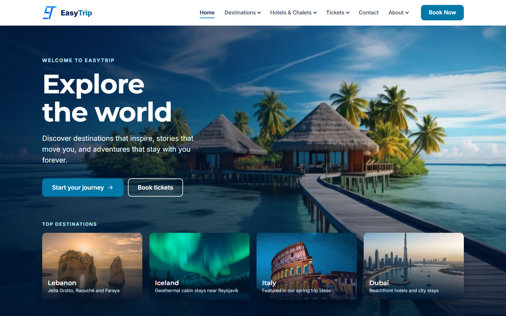
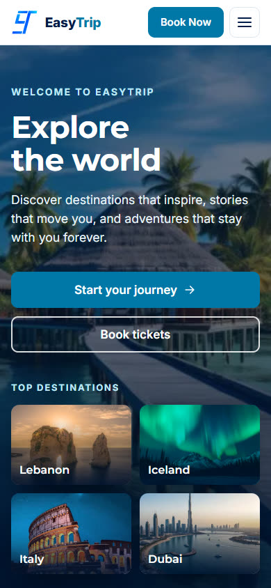

# EasyTrip — Travel Made Simple

EasyTrip is a travel website where visitors can explore destinations by season, browse hotels and
chalets, look at flight, bus and train tickets, and fill in a contact form.

> **University project.** The frontend was built for the Web Design course, and the Web Programming I
> course adds the backend. Hotels, chalets, prices and ticket planners are sample content: nothing
> can be booked or paid for yet.

**Tech stack:** HTML, CSS and vanilla JavaScript for the frontend, Node.js and Express for the server,
and MySQL for the database. The code follows the 3-tier architecture (presentation, business logic,
data access) with MVC: see [server/README.md](server/README.md#the-3-tier-architecture).

| Part | Status |
| --- | --- |
| Frontend (all pages) | Done |
| [Database](database/README.md) | Part 1 done: tables, sample data and example queries |
| [Server](server/README.md) | Part 2 done: register, log in, log out, and customer and admin roles |
| 3-tier structure | Part 3 done: models, controllers and routes, sessions saved in MySQL |
| Stays from the database | Part 4 done: the Stays API with search, filters, sorting and pages; the hotels and chalets pages use it |
| Admin page: manage stays | Part 5 done: add, edit and delete hotels and chalets, with image upload |
| Identity documents (first step towards hosts) | Done: "My account" reads a passport, ID card or driving licence from a photo, in Arabic and English (tesseract.js + mrz); the user checks or types the details and saves them as not verified |
| Contact messages | Done: the contact form saves messages in MySQL; the admin answers them from an inbox on the admin page; customers read the answers on "My account" |
| Email codes and Google sign-in | Done: every login ends with a 6-digit code sent by email (from a Gmail account), and "Continue with Google" is a second way to log in |
| Admin dashboard | Done: a side menu, an overview with totals and charts, and a read-only viewer of every database table |
| Tickets and emails | Part 7 done: flight, bus and train tickets are bought with credit at a sample fare, and an email is sent for each booking, ticket and credit change |
| Credit and bookings | Part 6 done: an admin adds credit to an account, the customer books a hotel or a chalet with it, and the admin confirms or cancels (a cancelled booking gives the credit back) |
| Identity verification | Part 8 done: a camera check (look straight, turn left and right, come closer: face-api, open source, in the browser), then a selfie holding the saved document; an admin approves or rejects it, and only verified customers can book stays and buy tickets |
| Admin tools, password reset, email replies | Part 8 done: the admin changes an account's role or deletes it, and manages the destinations; "Forgot your password?" sends a code by email; replies to contact messages are emailed |





---

## Contents

- [Pages](#pages)
- [Running the project](#running-the-project)
- [Database](#database)
- [Project structure](#project-structure)
- [Header and footer](#header-and-footer)
- [Common changes](#common-changes)
- [Accessibility and performance](#accessibility-and-performance)
- [Known limitations](#known-limitations)
- [Credits](#credits)

---

## Pages

All the pages are in the `public/` folder, with their `css/`, `js/` and `assets/` folders.

| Page | File | What it shows |
| --- | --- | --- |
| Home | `index.html` | Hero with the search card (Stays, Flights, Bus & train tabs), top destinations, about, seasonal trip ideas, services |
| Destinations | `destinations.html` | Seasonal travel guide: compare winter, spring, summer and autumn, choose by experience |
| Winter | `winter.html` | Winter travel guide: city breaks, mountain escapes and cozy stays, four featured countries, practical tips before planning, and links to sample stays, the planners and the other seasons |
| Spring / Summer / Autumn | `spring.html`, `summer.html`, `autumn.html` | Trip ideas and featured countries for each season; "Plan my ... trip" opens that season's stays |
| Hotels & chalets | `hotels-chalets.html` | Overview of the two kinds of stay, with links to each |
| Hotels / Chalets | `hotels.html`, `chalets.html` | The hotels or the chalets from the database: search by dates (only the stays free on those nights), guests, place, setting and price; the details window books with credit, with the searched dates already filled in |
| Stays (search results) | `stays.html` | Hotels and chalets together; the home search and the season pages' "Plan my ... trip" buttons open it with the search filled in |
| Tickets | `tickets.html` | Overview of the ticket types, with links to the two planners |
| Flights | `flight.html` | Flight planner (filled in and priced at once when opened from the home search): round trip / one way, validated form, search summary with a sample fare, "Buy with my credit" (no live schedules) |
| Bus & train | `bus-train.html` | Ground-travel planner (filled in and priced at once when opened from the home search): one form for bus or train, validation, route summary with a sample fare, "Buy with my credit" (no live schedules) |
| Who we are | `about.html` | What EasyTrip is, why it was built, what you can explore, its design principles and possible next steps |
| Why choose EasyTrip | `why-easytrip.html` | Why the connected frontend is useful: real page screenshots, four reasons the experience works, a four-step journey through the site, and what works today vs. what comes next |
| Contact | `contact.html` | Contact form with guidance and field-level validation; messages are saved for the admin (a logged-in user's name and email are filled in) |
| Forgot password | `forgot-password.html` | The account's email, then a code sent by email and a new password; the user is then logged in |
| Log in | `login.html` | Login form connected to the server, "Continue with Google", then the 6-digit code sent by email |
| Create an account | `register.html` | Registration form connected to the server, or "Continue with Google" |
| My account | `account.html` | A customer's details, their credit and its history, their bookings and tickets (with cancel), their identity document and its verification (a selfie holding it) (passport, ID card or driving licence) read from a photo, and their messages with the replies (needs login) |
| Admin dashboard | `admin.html` | Its own layout with a side menu: an overview (totals and charts), the hotels and chalets table with add, edit and delete, the messages inbox, the bookings and the tickets (confirm, cancel), the customers (credit, role, delete), the identity verifications (approve, reject), the destinations (add, edit, delete), the discounts (add, edit, delete), and a read-only viewer of the database tables (admins only) |

---

## Running the project

**With the server (everything works):** create the [database](#database), copy `.env.example` to
`.env` and fill in your MySQL password and a session secret (the Gmail and Google settings are
optional: without them the login code is printed in the server's terminal), then run these from the project folder.
The full steps are in [server/README.md](server/README.md#how-to-run-it).

```bash
npm install
```

```bash
npm start
```

Then open <http://localhost:3000>.

**The automated tests** (identity-document scanning, on synthetic documents; no server or database needed):

```bash
npm test
```

**Without the server:** open `public/index.html` in a modern browser (double-click it). The guide
pages and the planner forms still work, but logging in doesn't, and the hotels and chalets pages say
that the server is needed, because the stays are in the database.

---

## Database

The MySQL database is in the `database/` folder. To create it and add the sample data, run this
from the project folder (it asks for your MySQL password):

```bash
mysql -u root -p --default-character-set=utf8mb4 -e "source database/schema.sql; source database/seed.sql;"
```

[database/README.md](database/README.md) explains the tables, the ER diagram and the rules, and also
has the steps for MySQL Workbench.

---

## Project structure

```text
Easy_Trip/
├── package.json              Node.js packages and the npm start command
├── .env.example              Example settings (copy it to .env)
│
├── public/                   PRESENTATION LAYER: everything the browser downloads
│   ├── index.html            Homepage
│   ├── about.html            Who we are
│   ├── why-easytrip.html     Why choose EasyTrip
│   ├── contact.html          Contact form
│   ├── destinations.html     All destinations (by season)
│   ├── winter.html  spring.html  summer.html  autumn.html
│   ├── hotels-chalets.html  hotels.html  chalets.html
│   ├── stays.html            Search results: hotels and chalets together
│   ├── tickets.html  flight.html  bus-train.html
│   ├── login.html  register.html  Log in and create an account
│   ├── account.html  admin.html   Customer account and admin dashboard
│   │
│   ├── css/
│   │   ├── styles.css            Shared styles: header, footer, homepage, buttons
│   │   ├── reset.css             Older shared base styles (loaded by several pages)
│   │   ├── listings.css          Listing components (search card, cards, booking dialog) for hotels, chalets and stays
│   │   ├── hotels-chalets.css    Hotels & chalets overview page
│   │   ├── tickets.css           Tickets overview page
│   │   ├── cursor.css            Custom desktop cursor (loaded by js/cursor.js)
│   │   ├── ticket-buy.css        The "Buy with my credit" block of flight.html and bus-train.html
│   │   ├── auth.css              Login, register, account and admin pages
│   │   ├── admin.css             Admin dashboard: side menu, overview, charts, database viewer
│   │   └── <page>.css            One stylesheet per page (about, why-easytrip, flight, winter, …),
│   │                             each scoped under its page's <main> class (e.g. .about-page)
│   │
│   ├── js/
│   │   ├── nav.js                Navigation menu (dropdowns, mobile menu, current page); loads cursor.js after page load
│   │   ├── cursor.js             Custom desktop cursor (fine pointer only, off for reduced motion)
│   │   ├── home-flight.js        Homepage plane entrance animation (decorative, runs once)
│   │   ├── script.js             Scroll reveal: sections fade in as the visitor scrolls
│   │   ├── listings.js           Stays: sends the search card to GET /api/stays, shows the cards, show more, dialog
│   │   ├── home-search.js        Home: the search card's tabs, and its date checks
│   │   ├── guest-picker.js       Guests / travelers fields in the searches: a list of 1 to 5, or type up to 9
│   │   ├── admin-discounts.js    Admin page: the discounts (list, add, edit, delete, stays to leave out)
│   │   ├── booking.js            Hotels and chalets: the booking form in the dialog, paid with credit
│   │   ├── flight.js             Flight planner: trip type, swap, date limits, validation, search summary
│   │   ├── bus-train.js          Route planner: bus/train mode, trip type, swap, validation, route summary
│   │   ├── ticket-buy.js         Both planners: the sample fare of the summary's ticket, paid with credit
│   │   ├── contact.js            Contact form: checks, error summary, character count, sends the message
│   │   ├── auth.js               Login and register forms: checks, then sends them to the server
│   │   ├── login-code.js         Login, step 2: the 6-digit code from the email, "Send a new code"
│   │   ├── forgot-password.js    Forgot password: the email, then the code and the new password
│   │   ├── account.js            Account and admin pages: loads the user, the totals and log out
│   │   ├── admin-nav.js          Admin page: the side menu shows one section at a time
│   │   ├── admin-overview.js     Admin page: the bar charts and the "latest" lists
│   │   ├── admin-bookings.js     Admin page: the bookings table, confirm and cancel
│   │   ├── admin-tickets.js      Admin page: the tickets table, confirm and cancel
│   │   ├── admin-users.js        Admin page: the accounts: credit, role, delete
│   │   ├── admin-verifications.js Admin page: the identity documents and selfies, approve or reject
│   │   ├── admin-destinations.js Admin page: the destinations, add, edit, delete
│   │   ├── admin-database.js     Admin page: the read-only database viewer
│   │   ├── admin-stays.js        Admin page: the stays table and the add / edit / delete form
│   │   ├── admin-messages.js     Admin page: the messages inbox, reply, close / reopen, delete
│   │   ├── id-document.js        My account: read a document photo, check or type the details, save them
│   │   ├── verification.js       My account: the camera check and the selfie holding the document
│   │   ├── liveness-pose.mjs     The camera check's rules: head turn and size from the 68 face points
│   │   ├── document-camera.js    My account, on a phone: photograph the document inside its outline
│   │   ├── my-bookings.js        My account: the credit, its history, the bookings, the tickets and cancel
│   │   └── my-messages.js        My account: the messages sent while logged in, and the replies
│   │
│   ├── vendor/face-api/      face-api (MIT) and its two models, for the camera check
│   │
│   ├── assets/
│   │   ├── images/
│   │   │   ├── about/            About page images (WebP crops + a homepage screenshot)
│   │   │   ├── why/              Why choose EasyTrip images (road band + three page screenshots)
│   │   │   ├── brand/            Logo (logo.svg)
│   │   │   ├── home/             Homepage images (optimized .webp + fallbacks)
│   │   │   ├── destinations/     Destinations page images (optimized .webp + hero fallback)
│   │   │   ├── stays/            Hotels & chalets page images (optimized .webp)
│   │   │   ├── hotels/           Hotel card images (600×400 .webp crops)
│   │   │   ├── chalets/          Chalet card images (600×400 .webp crops)
│   │   │   ├── contact/          Contact page hero (.webp of support.png)
│   │   │   ├── tickets/          Tickets page images (optimized .webp)
│   │   │   ├── travel/           Transport images used by bus-train.html
│   │   │   ├── winter/           Winter page hero (.webp)
│   │   │   └── *.png / *.jpg     Season, destination, hotel and chalet images (.jpg fallbacks)
│
├── server/                   BUSINESS LOGIC and DATA ACCESS LAYERS (Node.js + Express)
│   ├── server.js             Starts the server: website, sessions, API routes, errors
│   ├── config.js             Reads the settings from .env
│   ├── routes/               Which URL goes to which controller (auth, admin, stays, bookings, destinations, id-document, inquiries)
│   ├── middleware/           Checks before a controller: is-auth.js, limit-attempts.js, upload-image.js, security-headers.js
│   ├── controllers/          The rules of each feature (auth, google, admin, accounts, verifications, stays, bookings, tickets, credit, destinations, id-document, inquiries, error)
│   ├── validators/           The server-side checks (auth, admin, stays, bookings, tickets, credit, id-document, inquiries, common)
│   ├── models/               The only files that run SQL (user, accommodation, booking, ticket, credit, destination, id-document, inquiry, stats, database-browser)
│   ├── utils/                database.js, path.js, file.js (uploads), document-reader.js (OCR + MRZ), printed-text.js,
│   │                         mailer.js (sends the emails), notices.js (writes them), login-code.js,
│   │                         google.js (Google sign-in), fares.js (the tickets' sample fares), money.js,
│   │                         selfie.js (the verification selfies, in private/selfies/)
│   └── README.md             The architecture, how to run it, the API, login and identity documents
│
├── private/                  Not served and not committed: the selfies waiting for an admin (private/selfies/)
│
├── test/                     Automated tests (npm test), with synthetic document photos in fixtures/
│
├── database/                 DATABASE (MySQL)
│   ├── schema.sql            Creates the database and its ten tables
│   ├── seed.sql              Sample data (the site's stays and destinations, plus test records)
│   ├── queries.sql           Example queries for each feature
│   ├── er-diagram.svg        ER diagram
│   └── README.md             How to run it and how the tables work
│
└── docs/
    ├── app-flow/             App flow diagram (draw.io + PNG/SVG) and its explanation
    ├── screenshots/          Images used in this README
    └── template-reference/   Original design template (kept locally only; not in the Git repository)
```

### Naming rules

- File and folder names are **lowercase with hyphens**: no spaces, capitals or accents
  (for example `jeita-grotto.png`, not `Jeita Grotto.png`). Many web hosts run Linux,
  where `Lebanon.png` and `lebanon.png` are different files.
- Page names describe the page: `about.html`, `contact.html`, `why-easytrip.html`.

---

## Header and footer

Every page contains its own copy of the same header (logo, main menu, Log in button) and
footer (links, copyright), so each page works on its own, even with JavaScript
turned off. **When you change the header or footer, make the same change in all 20 pages**
(your editor's "Replace in files" does this in one step). The admin dashboard (`admin.html`) is the
exception: it has its own side menu and no site header or footer.

`js/nav.js` runs the **navigation menu** on every page:

- The menu: **Home**, **Destinations** (Winter, Spring, Summer, Autumn), **Hotels & Chalets**
  (Hotels, Chalets), **Tickets** (Flights, Bus & train), **Contact**, **About** (Who we are, Why
  choose EasyTrip) and **Log in**, plus the **Book Now** button.
- In a dropdown, the word is a link to its own page (Destinations opens `destinations.html`, which
  shows the four seasons) and the arrow next to it opens the list. On a computer the list also
  opens when the mouse is over it.
- Below 1080px the menu collapses behind a menu button; there each list opens under its word.
- The current page is highlighted in the menu (`aria-current="page"` on its link). The word of a
  dropdown is also highlighted on the pages of its list (Destinations on the four season pages).
- **Log in** changes to **My account** when a customer is logged in, and to **Dashboard** for an
  admin.

---

## Common changes

### Add or change a menu link

Edit the `<nav class="et-nav">` list in the header of every page. A dropdown is an
`et-nav__item--has-menu et-nav__item--split` item (the word's link, the arrow button, then the
list); each link in the list looks like this:

```html
<li><a class="et-nav__menu-link" href="flight.html">Flight tickets</a></li>
```

### Add or edit a hotel or chalet

The hotels and chalets are rows in the `accommodations` table, not HTML. Each listing page only has
one card `<template>`, and `js/listings.js` fills a copy of it for each stay
that `GET /api/stays` returns. So a new row appears on the page at once, with no HTML to change.

**Use the admin page:** log in as an admin, open the admin dashboard, and use **Add a stay**, or
**Edit** and **Delete** in the "Hotels and chalets" table. The form asks for the name, hotel or
chalet, the destination, the kind and setting (chalets only, for the "Cabin · Mountain" label), the
price, a short description, a photo (JPG, PNG or WebP, up to 2 MB) and a description of the photo.
Uploaded photos are saved in `public/assets/images/uploads/`. Landscape photos (3 by 2, like
600×400) fit the cards best.

The site's own stays are also in `database/seed.sql`, so running it again brings them back as they
were.

The price slider at its highest value means "any price", so a stay that costs more than the slider's
maximum still shows.

### Link to the stays with a search

Every field of the search card can be set in the address, and the page keeps the address up
to date while the user searches (so the Back button and a shared link show the same results):

`stays.html?q=Lebanon&type=chalet&season=winter&start=2027-01-18&end=2027-01-20&guests=2`

`hotels.html` and `chalets.html` take the same `q`, `start`, `end` and `guests`
(for example `chalets.html?q=Lebanon&start=2027-01-18&end=2027-01-20`).

The home page's search opens the Stays page, `flight.html` or `bus-train.html` this way. The
planners take `from`, `to`, `depart`, `return` (no return: one way), `travelers`, and
`mode=bus` or `train` for the bus & train page; with all of them, the summary and the fare show
at once.

### Give a discount

On the admin dashboard, open **Discounts** and use **Add a discount**:

- **Discount (%)**: from 1 to 90.
- **On**: everything, all stays, hotels only, chalets only, or tickets only.
- **For**: leave it empty for every customer, or enter one customer's email.
- **First day / Last day** (optional): the days a customer can book or buy with it.
- **Leave these stays out**: tick the stays that keep their full price (for example two chalets
  of a chalets discount).

The stay cards show the old price crossed out and the new one, and the booking and ticket boxes show
the discount and the total. The server always works out the price itself (`server/utils/discounts.js`).
When several discounts fit, the customer gets only the biggest one. A customer's own discount shows
once they are logged in. Bookings and tickets keep the percent they got (`discount_percent`), so
editing or deleting a discount later doesn't change what was already paid.

### Link to the contact form with a topic

`contact.html?topic=flights` opens the contact form with that topic chosen. The topics are
`general`, `destinations`, `stays`, `flights`, `bus-train`, `website` and `other`.

### Brand colours

The main colours are CSS variables at the top of `css/styles.css`:

| Variable | Colour | Used for |
| --- | --- | --- |
| `--et-navy` | `#001B48` | Headings, footer, dark sections |
| `--et-royal` | `#02457A` | Button hover, gradients |
| `--et-primary` | `#0077A8` | Buttons and links (meets WCAG AA contrast with white) |
| `--et-sky` | `#018ABE` | Active-page underline, accents |

---

## Accessibility and performance

- A "Skip to main content" link, proper landmarks (`header`, `nav`, `main`, `footer`) and a
  logical heading order on the homepage.
- A visible focus outline on every link and button. Touch targets are about 44px.
- Colour contrast meets WCAG AA for text and buttons.
- Animations switch off for visitors who choose *reduce motion* in their system settings.
- Homepage images are resized WebP files (under 1 MB for the whole page), with sizes
  reserved to avoid layout jumps. The hero image loads first, and images further down load
  as you scroll.

---

## Known limitations

- **No real payment.** Hotels, chalets and tickets are paid with credit that an admin adds to the
  account; there is no card payment. The flight and bus & train planners have no live routes or
  schedules, so a ticket is a sample ticket at a sample fare.
- **Replies to visitors stay on the site.** A message sent while logged in gets its reply on "My
  account". A visitor without an account can send a message, but there is no email reply yet. The
  contact form needs JavaScript: without it, sending only reloads the page.
- **No social media links.** EasyTrip has no verified social accounts, so the footer doesn't link to any.
- The header's **Book Now** button leads to the tickets overview. Stays are booked from the hotels
  and chalets pages, and tickets are bought from the two planners.
- The copyright year in the footer is written into each page.
- Some pages still use the older `reset.css`, which duplicates parts of `styles.css`. The shared
  header and footer use their own `et-` class names, so it can't affect them.

---

## Credits

- Homepage layout adapted from the *Responsive Travel Website* template by
  [Bedimcode](https://www.youtube.com/@Bedimcode) (the original template is kept locally in
  `docs/template-reference/` and is not published in this repository),
  including the about, explore and join photos.
- Fonts: [Inter](https://rsms.me/inter/) and [Montserrat](https://fonts.google.com/specimen/Montserrat),
  via Google Fonts.


Email: admin@example.com
Password: Admin@123
