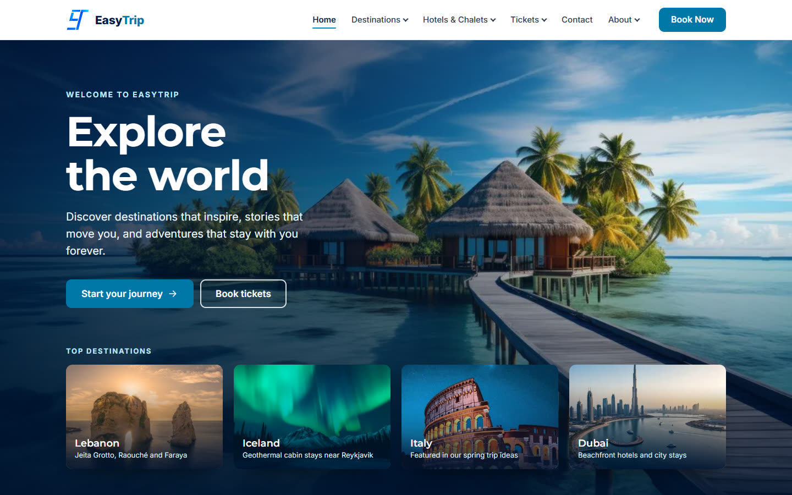
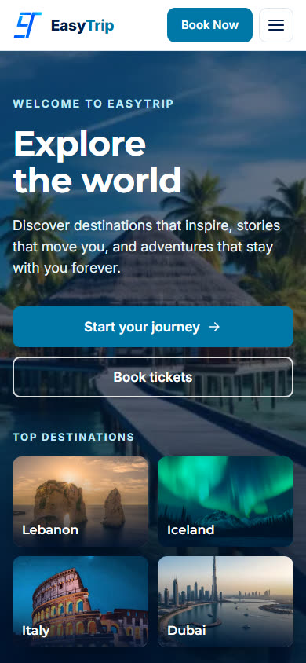

# EasyTrip — Travel Made Simple

EasyTrip is a travel website where visitors can explore destinations by season, browse hotels and
chalets, look at flight, bus and train tickets, and fill in a contact form.

> **University project.** The frontend was built for the Web Design course, and the Web Programming I
> course adds the backend. Hotels, chalets, prices and ticket planners are sample content: nothing
> can be booked or paid for yet, and the contact form doesn't send messages anywhere.

**Tech stack:** HTML, CSS and vanilla JavaScript for the frontend, Node.js and Express for the server,
and MySQL for the database. The code follows the 3-tier architecture (presentation, business logic,
data access) with MVC: see [server/README.md](server/README.md#the-3-tier-architecture).

| Part | Status |
| --- | --- |
| Frontend (all pages) | Done |
| [Database](database/README.md) | Part 1 done: tables, sample data and example queries |
| [Server](server/README.md) | Part 2 done: register, log in, log out, and customer and admin roles |
| 3-tier structure | Part 3 done: models, controllers and routes, sessions saved in MySQL |
| Stays from the database (search, filters, sorting, pages) | Part 4, next |
| Bookings, tickets, contact form, admin tools | Later parts |





---

## Contents

- [Pages](#pages)
- [Running the project](#running-the-project)
- [Database](#database)
- [Project structure](#project-structure)
- [Header and footer](#header-and-footer)
- [Common changes](#common-changes)
- [Accessibility and performance](#accessibility-and-performance)
- [Known limitations](#known-limitations)
- [Credits](#credits)

---

## Pages

All the pages are in the `public/` folder, with their `css/`, `js/` and `assets/` folders.

| Page | File | What it shows |
| --- | --- | --- |
| Home | `index.html` | Hero, top destinations, about, seasonal trip ideas, services, explore band |
| Destinations | `destinations.html` | Seasonal travel guide: compare winter, spring, summer and autumn, choose by experience |
| Winter | `winter.html` | Winter travel guide: city breaks, mountain escapes and cozy stays, four featured countries, practical tips before planning, and links to sample stays, the planners and the other seasons |
| Spring / Summer / Autumn | `spring.html`, `summer.html`, `autumn.html` | Trip ideas and featured countries for each season |
| Hotels & chalets | `hotels-chalets.html` | Accommodation guide: hotels vs chalets, quick comparison, what to consider |
| Hotels | `hotels.html` | Sample hotel collection: search, max sample price, sorting, "Show more", details dialog |
| Chalets | `chalets.html` | Sample chalets & private retreats: search, setting, max sample price, sorting, "Stays in Lebanon" shortcut, details dialog |
| All tickets | `tickets.html` | Transport choice: flights or bus & train, a quick comparison, a note that booking isn't connected yet |
| Flights | `flight.html` | Flight-planning prototype: round trip / one way, validated form, search summary (no live results) |
| Bus & train | `bus-train.html` | Ground-travel planning prototype: one form for bus or train, validation, route summary (no live results) |
| Who we are | `about.html` | What EasyTrip is, why it was built, what you can explore, its design principles and possible next steps |
| Why choose EasyTrip | `why-easytrip.html` | Why the connected frontend is useful: real page screenshots, four reasons the experience works, a four-step journey through the site, and what works today vs. what backend work could add |
| Contact | `contact.html` | Contact form with guidance, field-level validation and a confirmation (demo only: nothing is sent) |
| Log in | `login.html` | Login form connected to the server |
| Create an account | `register.html` | Registration form connected to the server |
| My account | `account.html` | A customer's details (needs login) |
| Admin dashboard | `admin.html` | Totals from the database (admins only) |

---

## Running the project

**With the server (everything works):** create the [database](#database), copy `.env.example` to
`.env` and fill in your MySQL password and a session secret, then run these from the project folder.
The full steps are in [server/README.md](server/README.md#how-to-run-it).

```bash
npm install
```

```bash
npm start
```

Then open <http://localhost:3000>.

**Without the server:** open `public/index.html` in a modern browser (double-click it). The browsing
pages and forms still work, but logging in doesn't. A static web host (GitHub Pages, Netlify) works the
same way if it publishes the `public/` folder.

---

## Database

The MySQL database is in the `database/` folder. To create it and add the sample data, run this
from the project folder (it asks for your MySQL password):

```bash
mysql -u root -p --default-character-set=utf8mb4 -e "source database/schema.sql; source database/seed.sql;"
```

[database/README.md](database/README.md) explains the tables, the ER diagram and the rules, and also
has the steps for MySQL Workbench.

---

## Project structure

```text
Easy_Trip/
├── package.json              Node.js packages and the npm start command
├── .env.example              Example settings (copy it to .env)
│
├── public/                   PRESENTATION LAYER: everything the browser downloads
│   ├── index.html            Homepage
│   ├── about.html            Who we are
│   ├── why-easytrip.html     Why choose EasyTrip
│   ├── contact.html          Contact form
│   ├── destinations.html     All destinations (by season)
│   ├── winter.html  spring.html  summer.html  autumn.html
│   ├── hotels-chalets.html   Hotels & chalets overview
│   ├── hotels.html  chalets.html  Listings with filters
│   ├── tickets.html          Tickets overview
│   ├── flight.html  bus-train.html
│   ├── login.html  register.html  Log in and create an account
│   ├── account.html  admin.html   Customer account and admin dashboard
│   │
│   ├── css/
│   │   ├── styles.css            Shared styles: header, footer, homepage, buttons
│   │   ├── reset.css             Older shared base styles (loaded by several pages)
│   │   ├── listings.css          Listing components (toolbar, cards, dialog) for hotels.html and chalets.html
│   │   ├── cursor.css            Custom desktop cursor (loaded by js/cursor.js)
│   │   ├── auth.css              Login, register, account and admin pages
│   │   └── <page>.css            One stylesheet per page (about, why-easytrip, flight, winter, …),
│   │                             each scoped under its page's <main> class (e.g. .about-page)
│   │
│   ├── js/
│   │   ├── nav.js                Navigation menu (dropdowns, mobile menu, current page); loads cursor.js after page load
│   │   ├── cursor.js             Custom desktop cursor (fine pointer only, off for reduced motion)
│   │   ├── home-flight.js        Homepage plane entrance animation (decorative, runs once)
│   │   ├── script.js             Scroll reveal (plus an old "stays" tab switcher no page uses any more)
│   │   ├── listings.js           Listing controller for hotels and chalets: filter, sort, show more, dialog
│   │   ├── flight.js             Flight planner: trip type, swap, date limits, validation, search summary
│   │   ├── bus-train.js          Route planner: bus/train mode, trip type, swap, validation, route summary
│   │   ├── contact.js            Contact form: checks, error summary, confirmation, character count
│   │   ├── auth.js               Login and register forms: checks, then sends them to the server
│   │   └── account.js            Account and admin pages: loads the user, the totals and log out
│   │
│   ├── assets/
│   │   ├── images/
│   │   │   ├── about/            About page images (WebP crops + a homepage screenshot)
│   │   │   ├── why/              Why choose EasyTrip images (road band + three page screenshots)
│   │   │   ├── brand/            Logo (logo.svg)
│   │   │   ├── home/             Homepage images (optimized .webp + fallbacks)
│   │   │   ├── destinations/     Destinations page images (optimized .webp + hero fallback)
│   │   │   ├── stays/            Hotels & chalets page images (optimized .webp)
│   │   │   ├── hotels/           Hotel card images (600×400 .webp crops)
│   │   │   ├── chalets/          Chalet card images (600×400 .webp crops)
│   │   │   ├── contact/          Contact page hero (.webp of support.png)
│   │   │   ├── tickets/          Tickets page images (optimized .webp)
│   │   │   ├── travel/           Transport images used by bus-train.html
│   │   │   ├── winter/           Winter page hero (.webp)
│   │   │   └── *.png / *.jpg     Season, destination, hotel and chalet images (.jpg fallbacks)
│
├── server/                   BUSINESS LOGIC and DATA ACCESS LAYERS (Node.js + Express)
│   ├── server.js             Starts the server: website, sessions, API routes, errors
│   ├── config.js             Reads the settings from .env
│   ├── routes/               Which URL goes to which controller (auth.js, admin.js)
│   ├── middleware/           Checks before a controller: is-auth.js, limit-attempts.js
│   ├── controllers/          The rules of each feature (auth.js, admin.js, error.js)
│   ├── validators/           The server-side form checks (auth.js, common.js)
│   ├── models/               The only files that run SQL (user.js, stats.js)
│   ├── utils/                database.js (MySQL pool), path.js (project folder)
│   └── README.md             The architecture, how to run it, the API and how login works
│
├── database/                 DATABASE (MySQL)
│   ├── schema.sql            Creates the database and its seven tables
│   ├── seed.sql              Sample data (the site's stays and destinations, plus test records)
│   ├── queries.sql           Example queries for each feature
│   ├── er-diagram.svg        ER diagram
│   └── README.md             How to run it and how the tables work
│
└── docs/
    ├── app-flow/             App flow diagram (draw.io + PNG/SVG) and its explanation
    ├── screenshots/          Images used in this README
    └── template-reference/   Original design template (kept locally only; not in the Git repository)
```

### Naming rules

- File and folder names are **lowercase with hyphens**: no spaces, capitals or accents
  (for example `jeita-grotto.png`, not `Jeita Grotto.png`). Many web hosts run Linux,
  where `Lebanon.png` and `lebanon.png` are different files.
- Page names describe the page: `about.html`, `contact.html`, `why-easytrip.html`.

---

## Header and footer

Every page contains its own copy of the same header (logo, main menu, Book Now button) and
footer (links, copyright), so each page works on its own, even with JavaScript
turned off. **When you change the header or footer, make the same change in all 19 pages**
(your editor's "Replace in files" does this in one step).

`js/nav.js` runs the **navigation menu** on every page:

- Desktop dropdowns open on hover, click or keyboard (Enter, Space, Arrow keys) and close with
  Escape, a click outside, or moving focus away.
- Below 1080px the menu collapses behind a menu button. Submenus expand in place, and
  **Book Now** stays visible.
- The current page is highlighted in the menu (`aria-current="page"` on its link).
- The last menu link says **Log in**, and changes to **My account** when the visitor is logged in.

---

## Common changes

### Add or change a menu link

Edit the `<nav class="et-nav">` list in the header of every page. A dropdown is an
`et-nav__item--has-menu` item; each link in it looks like this:

```html
<li><a class="et-nav__menu-link" href="flight.html">Flight tickets</a></li>
```

### Add or edit a hotel

Each hotel is an `<article class="lst-card">` inside the `lst-grid` in `hotels.html`. To add one,
copy an existing card and change:

- `data-name`, `data-location` and `data-price` (used by the search, the price filter and sorting)
- `data-order` and the `hotel-<number>-name` id (with the matching `aria-labelledby`) to the next number
- the image (`assets/images/hotels/hotel-<number>.webp`, a 600×400 WebP, plus the `.jpg` fallback) and its `alt` text
- the visible name, location, description and price

Then update the hotel count in `data-listing-count` ("27 hotels"). If the new price is outside the
price slider's range, update the slider's `min`/`max`/`value` and the `$600` shown next to it.

### Add or edit a chalet

Chalets work the same way in `chalets.html`. Each card also has a `data-setting`, which must be one
of the values in the "Setting" filter (`mountain`, `coastal`, `countryside`, `forest`, `desert`,
`tropical`), and a label such as "Cabin · Mountain". The "Stays in Lebanon" button fills the search
box with "Lebanon", so it finds every chalet whose location contains that word.

### Link to hotels or chalets with a search

`chalets.html?q=Lebanon` opens the chalets page with "Lebanon" in the search box, and
`hotels.html?q=Dubai` does the same for hotels. The homepage destination cards use these links.

### Link to the contact form with a topic

`contact.html?topic=flights` opens the contact form with that topic chosen. The topics are
`general`, `destinations`, `stays`, `flights`, `bus-train`, `website` and `other`.

### Brand colours

The main colours are CSS variables at the top of `css/styles.css`:

| Variable | Colour | Used for |
| --- | --- | --- |
| `--et-navy` | `#001B48` | Headings, footer, dark sections |
| `--et-royal` | `#02457A` | Button hover, gradients |
| `--et-primary` | `#0077A8` | Buttons and links (meets WCAG AA contrast with white) |
| `--et-sky` | `#018ABE` | Active-page underline, accents |

---

## Accessibility and performance

- A "Skip to main content" link, proper landmarks (`header`, `nav`, `main`, `footer`) and a
  logical heading order on the homepage.
- A visible focus outline on every link and button. Touch targets are about 44px.
- Colour contrast meets WCAG AA for text and buttons.
- Animations switch off for visitors who choose *reduce motion* in their system settings.
- Homepage images are resized WebP files (under 1 MB for the whole page), with sizes
  reserved to avoid layout jumps. The hero image loads first, and images further down load
  as you scroll.

---

## Known limitations

- **No booking or payment.** The flight and bus & train planners check what the visitor enters and
  show a summary, but there are no live routes, schedules or fares. Accounts work, but nothing is
  saved to them yet.
- **The contact form doesn't send anything.** It checks each field in the browser and then shows a
  confirmation that says the message wasn't sent. Without JavaScript, sending only reloads the page.
- **No social media links.** EasyTrip has no verified social accounts, so the footer doesn't link to any.
- The header's **Book Now** button leads to the tickets overview; nothing can actually be booked.
- The copyright year in the footer is written into each page.
- Some pages still use the older `reset.css`, which duplicates parts of `styles.css`. The shared
  header and footer use their own `et-` class names, so it can't affect them.

---

## Credits

- Homepage layout adapted from the *Responsive Travel Website* template by
  [Bedimcode](https://www.youtube.com/@Bedimcode) (the original template is kept locally in
  `docs/template-reference/` and is not published in this repository),
  including the about, explore and join photos.
- Fonts: [Inter](https://rsms.me/inter/) and [Montserrat](https://fonts.google.com/specimen/Montserrat),
  via Google Fonts.
