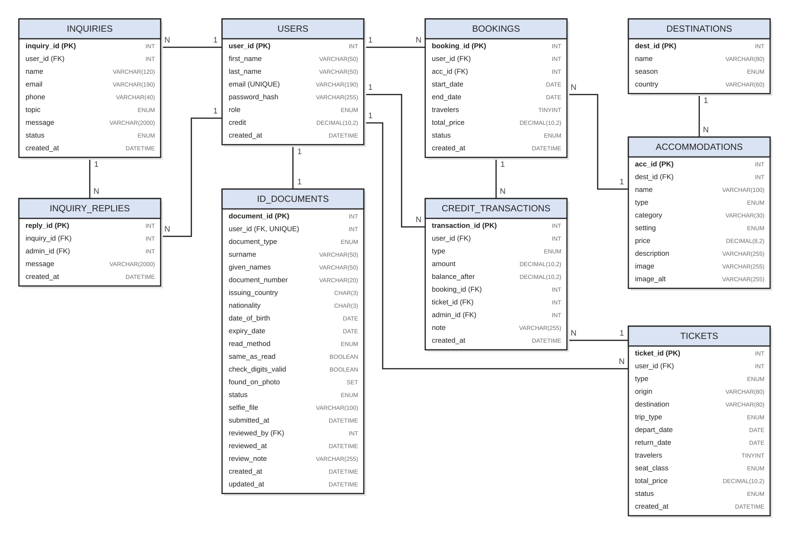

# EasyTrip Database (Part 1)

This folder has the MySQL database for EasyTrip, the Web Programming I project. It follows the
database design in our project proposal. The [server](../server/README.md) connects to it.

| File | What it does |
| --- | --- |
| `schema.sql` | Creates the `easytrip_db` database and its twelve tables |
| `seed.sql` | Adds the sample data: the site's 69 stays, 75 destinations and some test records |
| `queries.sql` | Example queries for each feature (search, bookings, "My trips", admin statistics) |
| `er-diagram.svg` | The ER diagram of the nine travel tables (every table except `sessions`) |

## How to run it

You need MySQL 8.0.16 or newer, because older versions ignore `CHECK` rules.

**With the command line.** Open a terminal in the project folder and run this. It asks for your
MySQL root password:

```bash
mysql -u root -p --default-character-set=utf8mb4 -e "source database/schema.sql; source database/seed.sql;"
```

**With MySQL Workbench.** Choose *File > Open SQL Script*, open `schema.sql` and run it with the
lightning button. Do the same for `seed.sql`, then for `queries.sql` to see the example results.

Running `schema.sql` again deletes the ten tables and their data, so run `seed.sql` after it to
start fresh.

**A database made before credit and paid tickets** needs two new columns and a new table. This
keeps all your data: run the two lines below, then the `CREATE TABLE credit_transactions`
statement from `schema.sql`.

For identity verification, `id_documents` also gets the columns `status`, `selfie_file`,
`liveness_steps`, `submitted_at`, `reviewed_by`, `reviewed_at` and `review_note`: copy their lines from `schema.sql`
into an `ALTER TABLE id_documents ADD COLUMN ...` statement.

```sql
ALTER TABLE users ADD COLUMN credit DECIMAL(10,2) NOT NULL DEFAULT 0.00 AFTER role,
  ADD CONSTRAINT chk_users_credit CHECK (credit >= 0);
ALTER TABLE tickets ADD COLUMN total_price DECIMAL(10,2) NULL AFTER seat_class,
  ADD CONSTRAINT chk_tickets_total CHECK (total_price IS NULL OR total_price >= 0);
```

**A database made before Google sign-in** needs one change, so that an account made with Google can
have no password. This keeps all your data:

```sql
ALTER TABLE users MODIFY password_hash VARCHAR(255) NULL;
```

**A database made before identity documents** has no `id_documents` table. Running `schema.sql`
and `seed.sql` again (the command above) adds it, but it also resets every table to the sample data.

### Test accounts

These accounts are made-up test data for local use only:

| Role | Email | Password |
| --- | --- | --- |
| Admin | `admin@example.com` | `Admin@123` |
| Customer | `lara.haddad@example.com` | `Customer@123` |

The other customers in `seed.sql` use the same password. Only the bcrypt hash is stored in the
database, so the real password can't be read from the `users` table. An account made with
"Continue with Google" has no password: its `password_hash` is `NULL`.

Every login ends with a code sent by email. These test addresses (`@example.com`) can't get email,
so on your own computer the code is also printed in the server's terminal (see the
[server README](../server/README.md#email-codes-the-second-step-of-every-login)).

## ER diagram



## The tables

| Table | What it stores | Relationship |
| --- | --- | --- |
| `users` | Customer and admin accounts, each with its credit | Has many bookings, tickets, inquiries and credit_transactions; has at most one id_documents row |
| `destinations` | Places on the website, by season | Has many accommodations |
| `accommodations` | The hotels and chalets | Belongs to one destination, has many bookings |
| `bookings` | Reservations of a hotel or chalet | Belongs to one user and one accommodation |
| `credit_transactions` | Every change of a user's credit: added or removed by an admin, used for a booking or a ticket, or refunded | Belongs to one user; can point to one booking or one ticket, and to the admin who made the change |
| `tickets` | Flight, bus and train tickets, with the price paid | Belongs to one user |
| `inquiries` | Messages from the contact form | Can belong to one user, or none for a visitor; has many inquiry_replies |
| `inquiry_replies` | The admins' answers to the contact messages | Belongs to one inquiry and to the admin who wrote it |
| `id_documents` | The passport, ID card or driving licence a user scanned and saved, and the admin's review of it | Belongs to one user (`UNIQUE user_id`); deleted with the user |
| `discounts` | A percentage off made by an admin: for every customer or one, on everything, stays, hotels, chalets or tickets, with optional dates | Can belong to one user (deleted with the user); has many discount_exclusions |
| `discount_exclusions` | The stays a discount leaves out | Belongs to one discount and one accommodation (deleted with either) |
| `sessions` | Who is logged in, one row per logged-in browser | None: the server's session store uses it |

The `id_documents` table was added with identity documents (see the
[server README](../server/README.md#identity-documents)). It never stores the photo, only the
details. `document_type` is `passport`, `id_card` or `driving_licence`, and `read_method` says where
the details came from:

| `read_method` | When | Its columns |
| --- | --- | --- |
| `machine_code` | Read from the document's code (every passport, most ID cards) | `same_as_read`: the user saved exactly what was read; `check_digits_valid`: every check digit was correct |
| `typed` | Typed by the user, because there is no code (most driving licences, some ID cards) | `found_on_photo`: the typed details found in the photo's printed text, a `SET` such as `surname,date_of_birth` |

None of these columns proves that the document is genuine: an admin does that. `status` is their
review: `unverified` (no selfie yet), `pending` (a selfie waits in `private/selfies/`, named in
`selfie_file`; `liveness_steps` lists the camera check's movement photos saved next to it, or is
`NULL` for an uploaded photo), `verified` or `rejected` (`review_note` says why). `reviewed_by` is the admin who
decided (`SET NULL` if that account is deleted). Only a `verified` user can book. The table's `CHECK` rules keep the
rows consistent: each method fills only its own columns, a passport is always read from its code, a
driving licence is always typed and has no `nationality` (a licence doesn't say it), and the other
documents must have one. `issuing_country` and `nationality` are ICAO 3-letter codes. A passport
number has at most 9 characters (its place in the code), the others up to 20; names up to 50, in
Arabic or Latin letters. `expiry_date` is `NULL` for a document that never expires (some ID cards
and driving licences); a passport must have one.

The `credit` column of `users` and the `credit_transactions` table were added with credit and
bookings (see the [server README](../server/README.md#credit-and-bookings)). `users.credit` is the
balance: the money an admin gave the account, which the user spends on bookings. Every change of it
is also one row in `credit_transactions`, like a line of a bank statement:

| `type` | Who | `amount` |
| --- | --- | --- |
| `top_up` | An admin added credit | Above zero |
| `deduction` | An admin removed credit | Below zero |
| `booking` | The user paid for a booking (`booking_id`) | Below zero |
| `ticket` | The user paid for a ticket (`ticket_id`) | Below zero |
| `refund` | A paid booking or ticket was cancelled (`booking_id` or `ticket_id`) | Above zero |

`balance_after` is the credit right after the change. The balance and its row are saved in one
transaction, so they always match, and `CHECK` rules keep the credit at zero or more and the sign
of `amount` right for its `type`.

`tickets.total_price` was added with paid tickets: what the user paid for the whole ticket, at a
sample fare (see the [server README](../server/README.md#tickets)). It is `NULL` for the sample
tickets in `seed.sql`, which were saved before tickets had a price.

The `inquiry_replies` table was added with the contact messages (see the
[server README](../server/README.md#contact-messages)). A message can have several replies (one-to-many),
so the replies have their own table instead of a column in `inquiries`. `admin_id` says which admin
answered. `inquiries.status` got a fourth value, `answered`: `new` (nobody opened it), `read`,
`answered` (it has a reply) and `closed`. Saving a reply and setting `answered` is one transaction,
so a message is never `answered` without a reply.

The `sessions` table was added in Part 3, when login moved to sessions saved in MySQL (see the
[server README](../server/README.md#how-login-works)). The session store writes a row at login and
deletes it at logout. The row only holds the user's id, and the browser only gets the signed session
ID. It has the store's own table definition, so the server can also create the table if it is
missing. It isn't in the ER diagram because it isn't part of the travel data.

### Changes from the proposal's ER diagram

The five tables and their relationships are the same as in the proposal. While matching the
database to the website, we made these changes:

| Change | Why |
| --- | --- |
| Added the `inquiries` table | The proposal says contact messages are saved for the admin, but the first diagram had no table for them |
| Added the `inquiry_replies` table | The admin answers the messages from the admin page, and the customer reads the answers on "My account" |
| `tickets.route` became `origin` and `destination` | The forms ask for "From" and "To" separately, and each column should hold one value |
| `tickets.date` became `depart_date` and `return_date` | The forms support round trips, and `date` is also a MySQL type name |
| Added `trip_type`, `travelers`, `seat_class` and `status` to `tickets` | The flight and bus & train forms collect them, and the app flow gives tickets a status |
| Added `end_date`, `travelers` and `total_price` to `bookings` | A stay needs an end date, and the reservation flow confirms the travelers and the price |
| Added `category`, `setting`, `description`, `image` and `image_alt` to `accommodations` | The hotel and chalet cards show them, and the chalets page filters by setting |
| Added `created_at` to `users`, `bookings`, `tickets` and `inquiries` | The admin statistics need dates, like new customers per month |

## Rules the database enforces

The website checks the forms in the browser, but those checks can be skipped. So the main rules are
also in the database:

- **Unique values:** an email can only be registered once, and a place can't be listed twice in the
  same season.
- **Allowed values:** roles, seasons, statuses, ticket types and contact topics must be one of the
  listed values (`ENUM`).
- **Dates:** a stay must end after it starts, a return can't be before the departure, a round trip
  needs a return date and a one-way trip can't have one.
- **Tickets:** origin and destination must be different, and the seat class must fit the transport
  (a bus can't be "business").
- **Numbers:** the price must be above zero and travelers must be from 1 to 9, like the forms.
- **Credit:** a user's credit can't go below zero, and a row of the credit history must have the
  right sign for its type (money in above zero, money out below zero).

### What happens when a record is deleted

| Deleting a... | Result | Why |
| --- | --- | --- |
| User | Their bookings, tickets and credit history are deleted too (`CASCADE`) | They belong to that user |
| Booking or ticket | Its payment and refund rows stay, with `booking_id` or `ticket_id` set to `NULL` (`SET NULL`) | The credit history must stay complete |
| User | Their inquiries stay, with `user_id` set to `NULL` (`SET NULL`) | The admin may still need the message |
| Admin who replied | The replies stay, with `admin_id` set to `NULL` (`SET NULL`) | The answer is still part of the conversation |
| Inquiry | Its replies are deleted too (`CASCADE`) | A reply means nothing without its message |
| Accommodation with bookings | Refused (`RESTRICT`) | Bookings must not lose their stay |
| Destination with accommodations | Refused (`RESTRICT`) | Stays must not lose their destination |

## Limits of this part

- The website now uses every table: `users`, `sessions`, `accommodations`, `destinations`,
  `bookings`, `tickets`, `credit_transactions`, `id_documents`, `inquiries` and `inquiry_replies` (accounts, the admin totals, the hotels and
  chalets pages, the admin's stays table and messages inbox, the contact form, and the identity
  document and messages on "My account"). The
  `accommodations.image` column keeps the image's path, never the image itself. The season and destination pages
  still show their own HTML content, because they are travel guides, not lists.
- Two bookings for the same dates are prevented by a query in the backend (`models/booking.js`), not
  by a table rule. The same query is in section 4 of `queries.sql`.
- A place has one season per row. To feature it in another season, add another row.
- Prices are sample prices in US dollars. A ticket's price is a sample fare (one price per
  transport and class), because the site has no real fares.

## Next part

Every table is now connected to the website. The next parts add admin tools, not tables.
