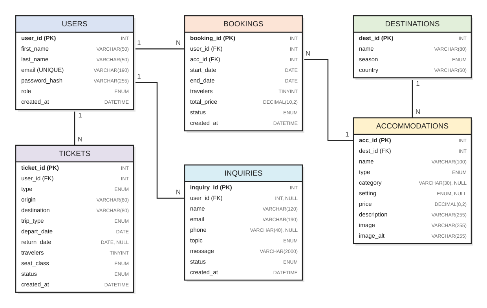

# EasyTrip Database (Part 1)

This folder has the MySQL database for EasyTrip, the Web Programming I project. It follows the
database design in our project proposal. The [server](../server/README.md) connects to it.

| File | What it does |
| --- | --- |
| `schema.sql` | Creates the `easytrip_db` database and its seven tables |
| `seed.sql` | Adds the sample data: the site's 54 stays, 60 destinations and some test records |
| `queries.sql` | Example queries for each feature (search, bookings, "My trips", admin statistics) |
| `er-diagram.svg` | The ER diagram of the final tables |

## How to run it

You need MySQL 8.0.16 or newer, because older versions ignore `CHECK` rules.

**With the command line.** Open a terminal in the project folder and run this. It asks for your
MySQL root password:

```bash
mysql -u root -p --default-character-set=utf8mb4 -e "source database/schema.sql; source database/seed.sql;"
```

**With MySQL Workbench.** Choose *File > Open SQL Script*, open `schema.sql` and run it with the
lightning button. Do the same for `seed.sql`, then for `queries.sql` to see the example results.

Running `schema.sql` again deletes the seven tables and their data, so run `seed.sql` after it to
start fresh.

### Test accounts

These accounts are made-up test data for local use only:

| Role | Email | Password |
| --- | --- | --- |
| Admin | `admin@example.com` | `Admin@123` |
| Customer | `lara.haddad@example.com` | `Customer@123` |

The other customers in `seed.sql` use the same password. Only the bcrypt hash is stored in the
database, so the real password can't be read from the `users` table.

## ER diagram



## The tables

| Table | What it stores | Relationship |
| --- | --- | --- |
| `users` | Customer and admin accounts | Has many bookings, tickets and inquiries |
| `destinations` | Places on the website, by season | Has many accommodations |
| `accommodations` | The hotels and chalets | Belongs to one destination, has many bookings |
| `bookings` | Reservations of a hotel or chalet | Belongs to one user and one accommodation |
| `tickets` | Flight, bus and train plans | Belongs to one user |
| `inquiries` | Messages from the contact form | Can belong to one user, or none for a visitor |
| `sessions` | Who is logged in, one row per logged-in browser | None: the server's session store uses it |

The `sessions` table was added in Part 3, when login moved to sessions saved in MySQL (see the
[server README](../server/README.md#how-login-works)). The session store writes a row at login and
deletes it at logout. The row only holds the user's id, and the browser only gets the signed session
ID. It has the store's own table definition, so the server can also create the table if it is
missing. It isn't in the ER diagram because it isn't part of the travel data.

### Changes from the proposal's ER diagram

The five tables and their relationships are the same as in the proposal. While matching the
database to the website, we made these changes:

| Change | Why |
| --- | --- |
| Added the `inquiries` table | The proposal says contact messages are saved for the admin, but the first diagram had no table for them |
| `tickets.route` became `origin` and `destination` | The forms ask for "From" and "To" separately, and each column should hold one value |
| `tickets.date` became `depart_date` and `return_date` | The forms support round trips, and `date` is also a MySQL type name |
| Added `trip_type`, `travelers`, `seat_class` and `status` to `tickets` | The flight and bus & train forms collect them, and the app flow gives tickets a status |
| Added `end_date`, `travelers` and `total_price` to `bookings` | A stay needs an end date, and the reservation flow confirms the travelers and the price |
| Added `category`, `setting`, `description`, `image` and `image_alt` to `accommodations` | The hotel and chalet cards show them, and the chalets page filters by setting |
| Added `created_at` to `users`, `bookings`, `tickets` and `inquiries` | The admin statistics need dates, like new customers per month |

## Rules the database enforces

The website checks the forms in the browser, but those checks can be skipped. So the main rules are
also in the database:

- **Unique values:** an email can only be registered once, and a place can't be listed twice in the
  same season.
- **Allowed values:** roles, seasons, statuses, ticket types and contact topics must be one of the
  listed values (`ENUM`).
- **Dates:** a stay must end after it starts, a return can't be before the departure, a round trip
  needs a return date and a one-way trip can't have one.
- **Tickets:** origin and destination must be different, and the seat class must fit the transport
  (a bus can't be "business").
- **Numbers:** the price must be above zero and travelers must be from 1 to 9, like the forms.

### What happens when a record is deleted

| Deleting a... | Result | Why |
| --- | --- | --- |
| User | Their bookings and tickets are deleted too (`CASCADE`) | They belong to that user |
| User | Their inquiries stay, with `user_id` set to `NULL` (`SET NULL`) | The admin may still need the message |
| Accommodation with bookings | Refused (`RESTRICT`) | Bookings must not lose their stay |
| Destination with accommodations | Refused (`RESTRICT`) | Stays must not lose their destination |

## Limits of this part

- So far the website uses the `users`, `sessions`, `accommodations` and `destinations` tables
  (accounts, the admin totals, and the hotels and chalets pages). The season and destination pages
  still show their own HTML content, because they are travel guides, not lists.
- Two bookings for the same dates will be prevented by a query in the backend, not by a table rule. The
  query is in section 4 of `queries.sql`.
- A place has one season per row. To feature it in another season, add another row.
- Prices are sample prices in US dollars. Tickets have no price because the site has no real fares.

## Next part

The admin page manages the stays (Part 5), then the bookings, tickets and contact form are connected
to these tables.
